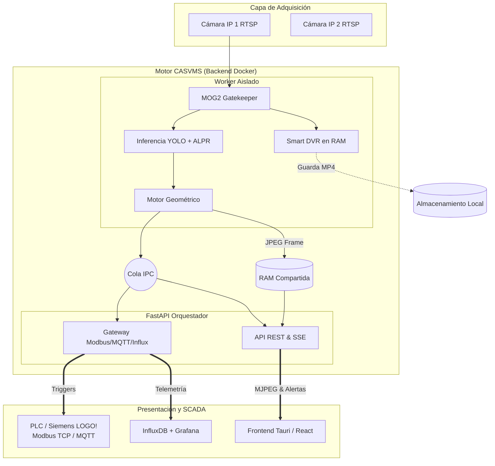

# 👁️ CASVMS: Industrial AI Video Management System


**CASVMS** es un Sistema de Gestión de Vídeo (VMS) multiplataforma de alto rendimiento diseñado para la automatización de infraestructuras, *facility management* e industria 4.0. 

Construido bajo una estricta filosofía **zero-cloud**, garantiza la soberanía total de los datos operativos. Procesa múltiples flujos RTSP localmente mediante aceleración de hardware (Intel OpenVINO) y transforma las cámaras de seguridad en sensores IoT inteligentes, conectando la analítica de vídeo directamente con autómatas (PLCs), sistemas SCADA y plataformas domóticas.

---

## ✨ Características Principales

*   🧠 **Inferencia Edge Optimizada:** Ejecución de YOLOv8/v10 sobre iGPU (Intel QuickSync/OpenVINO), liberando la CPU principal.
*   🛑 **Gatekeeper de Movimiento (MOG2):** El motor neuronal entra en *standby* dinámico si no hay alteración de píxeles, reduciendo el consumo eléctrico y térmico.
*   📐 **Motor Analítico Vectorial:** Intrusión perimetral por polígonos, contadores direccionales (Tripwires) y detección de merodeo/aparcamiento.
*   🚗 **ALPR Integrado:** Reconocimiento de matrículas con OCR optimizado para visión nocturna e integración con base de datos local (SQLite) para control de barreras.
*   📼 **Smart DVR:** Búfer circular en memoria RAM con compresión JPEG en tiempo real. Exporta clips MP4 de evidencias sin colapsar el servidor.
*   🏭 **Comunicaciones Industriales I/O:** Pasarela nativa Modbus TCP, publicación MQTT jerárquica y telemetría de aforo en InfluxDB.
*   💻 **GUI Nativa Multidispositivo:** Frontend (Windows/macOS/Linux) en Tauri/React con streaming MJPEG, visor SSE y editor de reglas vectoriales (Zoom/Pan matricial).

---

## 📐 Arquitectura Lógica

CASVMS utiliza un diseño de **Multiprocesamiento Aislado**. Cada cámara opera en un núcleo de CPU independiente, enviando alertas y telemetría al Orquestador Central mediante colas IPC.



---

## 🚀 Despliegue del Backend e Infraestructura (Docker)

### 1. Variables de Entorno
Copia el archivo de plantilla `.env.example` para generar tu entorno local:
```bash
cp .env.example .env
```

### 2. Iniciar el Stack con Aceleración por Hardware (Intel iGPU)
En cualquier Mini PC Linux (Intel Gen 8/9/10/11/12/13/Ultra):
```bash
# Validar disponibilidad del nodo iGPU
ls -la /dev/dri

# Compilar y arrancar el stack completo
docker compose up -d --build
```

**Servicios desplegados:**
*   **FastAPI / VMS Engine**: `http://localhost:8000` (Documentación interactiva en `/docs`)
*   **Streaming MJPEG**: `http://localhost:8000/stream/{camera_id}`
*   **SSE Alertas**: `http://localhost:8000/api/alerts/sse`
*   **Modbus TCP Server**: Puerto `5020` (Holding Registers)
*   **InfluxDB 2.7**: `http://localhost:8086`
*   **Grafana Dashboards**: `http://localhost:3000` (`admin` / `admin`)
*   **Mosquitto MQTT**: Puerto `1883`

---

## 📦 Aplicaciones Autoejecutables y Binarios (Windows & Debian/Ubuntu)

CASVMS incluye ejecutables nativos precompilados de alto rendimiento tanto para Windows (`.exe`) como para Linux Debian/Ubuntu (`.deb` / binario nativo):

### 🪟 Windows (1-Click Autoejecutable)
1. **Lanzador Automatizado 1-Click** (levanta el stack Docker y arranca la interfaz):
   ```cmd
   CASVMS-Launcher.bat
   ```
   *(o en PowerShell:* `.\Start-CASVMS.ps1`*)*

2. **Binario de Escritorio Nativo**:
   * Ubicación: `release/windows/CASVMS.exe` (23.8 MB, optimizado en release).

---

### 🐧 Linux (Debian / Ubuntu / Raspbian x86_64)
1. **Instalación Automatizada con Paquete `.deb`**:
   ```bash
   chmod +x install_debian.sh start_linux.sh
   sudo ./install_debian.sh
   ```
   *Instala dependencias del sistema, integra el acceso directo `/usr/share/applications/casvms.desktop` y el comando `casvms`.*

2. **Lanzador Automatizado 1-Click**:
   ```bash
   ./start_linux.sh
   ```

3. **Paquete y Binario Directo**:
   * Paquete Debian: `release/linux/casvms_1.0.0_amd64.deb`
   * Binario ejecutable ELF: `release/linux/casvms-desktop`

---

## 💻 Entorno de Desarrollo (Frontend Tauri + React + TypeScript)

### Modo Desarrollo Web:
```bash
cd frontend
npm install
npm run dev
```

### Modo Desarrollo de Escritorio (Tauri):
```bash
cd frontend
npm run tauri dev
```

---

## ⚙️ Mapeo de Registros Modbus TCP (PLCs / SCADA)

| Dirección | Registro | Tipo | Descripción |
|---|---|---|---|
| `40001` | `0` | INT16 | **Aforo Actual** (Personas dentro del recinto) |
| `40002` | `1` | INT16 | **Alarma Sobre-Aforo** (`1` si Aforo $\ge$ Límite, `0` normal) |
| `40003` | `2` | INT16 | **Contador Total IN** (Entradas acumuladas) |
| `40004` | `3` | INT16 | **Contador Total OUT** (Salidas acumuladas) |
| `40005` | `4` | INT16 | **Alarma de Intrusión Perimetral** (`1` si activa) |
| `40006` | `5` | INT16 | **Límite de Aforo Máximo** (Lectura/Escritura por PLC) |

---

## 🚗 Control de Acceso ALPR y Automatización de Barrera

CASVMS incorpora una arquitectura de IA en cascada (**Dual-Stage AI**) para parking y control perimetral:

1. **Inferencia Macro:** Detección de vehículos con YOLOv8 y ByteTrack.
2. **Discriminación de Rumbo:** Detección por masa lumínica en HSV (`APPROACHING` vs `DEPARTING`).
3. **Inferencia Micro:** Localización de placa (`imgsz=320` OpenVINO FP16 en $<4\text{ ms}$).
4. **Filtro OCR Óptico:** EasyOCR con ecualización adaptativa CLAHE y filtro bilateral.
5. **Accionamiento Físico:** Disparo de pulso no bloqueante (2 segundos, FC05) sobre PLC de barrera vía Modbus TCP.
